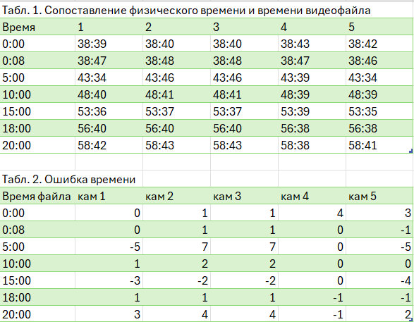

# Методика и результаты тестирования

Документ предназначен для фиксации результатов проверки рабочего приложения видеоаналитики и подключаемых unified-результатов. Поля со значением `TODO` заполняются проверяющим после выполнения тестов. Сырые файлы, логи и контрольные суммы следует сохранять в `hacathon_template-main/artifacts/test-results/` или в другом согласованном каталоге артефактов.

## 1. Цель тестирования

Проверить, что приложение:

- запускается в заявленном окружении и отвечает через web-интерфейс;
- принимает исходные видео из `data/` в форматах MKV и MP4;
- запускает unified-конвейер с выбором шага кадров и временного отрезка;
- создаёт последовательный эксперимент в `runs/<N>/`;
- формирует `tracks_projection.json`, `embeddings.json` и tracked-видео;
- подключает готовые результаты из `runs/demo_1` или `runs/demo_2`;
- корректно показывает и воспроизводит видео всех камер;
- поддерживает общую кнопку запуска и паузы видео;
- отдаёт видео потоково с поддержкой HTTP byte ranges;
- сохраняет ожидаемую структуру unified-результата.

## 2. Подготовка

1. Создать или активировать виртуальное окружение.
2. Установить зависимости из `requirements.txt`.
3. Проверить наличие модели `yolo11m.pt`, файлов `camera_graph.json`, `camera_calibrations.json` и `office_map.json`.
4. Подготовить исходные видео и записать их имена, разрешение, FPS, длительность и размер.
5. Запустить сервер командой из `docs/OPERATIONS.md`.
6. Проверить `GET /api/health` и сохранить ответ в логах.
7. Очистить или отдельно обозначить каталог результатов тестового запуска.

## 3. Методика функционального тестирования

### 3.1. Запуск анализа

1. Открыть web-интерфейс по адресу `http://127.0.0.1:8000`.
2. Открыть форму «Новый анализ».
3. Указать папку исходных видео.
4. Проверить значения по умолчанию: шаг `20`, начало `60` секунд, конец `90` секунд.
5. Запустить анализ и зафиксировать ID задания, номер эксперимента и время выполнения.
6. Дождаться статуса `completed`.
7. Проверить наличие файлов:

   - `runs/<N>/tracks_projection.json`;
   - `runs/<N>/embeddings.json`;
   - `runs/<N>/tracked/*.mp4`.

8. Сверить число камер в отчёте с числом входных видео.
9. Проверить, что tracked-видео открывается в браузере и содержит bbox.

Чтобы сократить время на расчёты, демонстрация имеет большой шаг =20, из-за чего трекер работает плохо. 
В репозитории лежит эксперимент с шагом в 3 кадра, полученный из исходных видео на интервале 75-120 сек. Подключим его:

### 3.2. Подключение готового результата

Проверить оба варианта пути:

- корень результата: `runs/demo_1`; - это надо ввести в графу "папка..."
- каталог видео: `runs/demo/tracked`.

- корень результата: `runs/H264`;
- каталог видео: `runs/H264/tracked`.

Для каждого варианта:

1. Открыть «Подключить результат».
2. Указать путь и подключить результат.
3. Проверить создание записи эксперимента.
4. Открыть эксперимент.
5. Пользуясь общей кнопкой запуска/паузы (слева) наблюдать треки с 5 камер синхронизированно.

Кстати, в ходе выполнения задания было обнаружено, что физическое время сверху на записи может отставать и спешить в разные моменты видео (ошибка до 10 секунд!), что осложняет реализацию синхронизации трека с разных камер.

